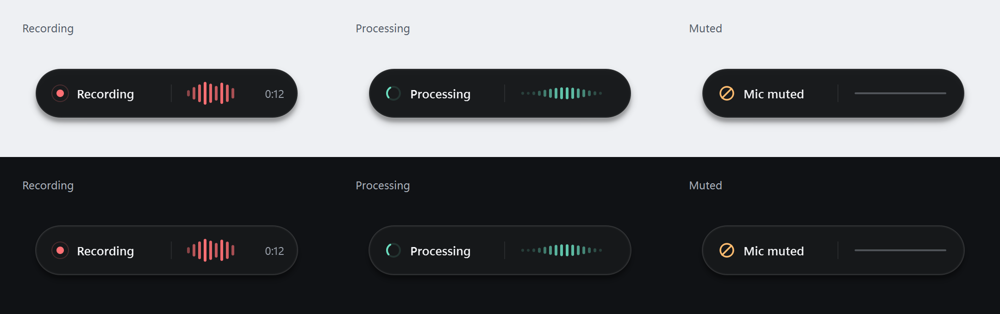

# Whisper Dictate - Fast Voice Dictation for Windows

Voice dictation for Windows. Hold Right Ctrl, speak, release: clean text is pasted into the focused app. Uses [Groq Whisper Large v3 Turbo](https://console.groq.com/docs/model/whisper-large-v3-turbo) for transcription and [Qwen 3.8 27B on Groq](https://console.groq.com/docs/model/qwen/qwen3.8-27b) for cleanup, with GPT-OSS 120B fallback. One Groq API key covers both stages.

Auto-detects **English and Russian** per utterance (Whisper supports 99+ languages).

**451ms measured median from key release to text insertion. No app subscription.**
Source available for noncommercial use; cloud API usage is billed by Groq.



## Models

| Stage | Exact Groq Model ID | App Settings |
|---|---|---|
| Audio transcription | `whisper-large-v3-turbo` | Temperature 0; automatic language detection |
| Text cleanup | `qwen/qwen3.8-27b` | Temperature 0; reasoning disabled; tone-aware cleanup |
| Cleanup fallback | `openai/gpt-oss-120b` | Temperature 0.2; low reasoning effort |

The audio is captured at the microphone's native rate, resampled to 16kHz mono,
and uploaded as lossless 16-bit FLAC. Cleanup receives text only. Qwen is a
[preview model](https://console.groq.com/docs/model/qwen/qwen3.8-27b); GPT-OSS
is used if the primary request fails or conservative content checks flag a result.
If cleanup fails overall, the app preserves the raw Whisper transcript.

## Speed

The tested F9 implementation was promoted to the main app on 2026-10-13; its hotkey is now Right Ctrl. It uses Qwen 3.8 27B at temperature zero with reasoning disabled, the same tone prompts, a shared warmed Groq connection, microphone stream reuse, and verified batched clipboard paste. Audio saving and processing before release are disabled.

Measured on one Windows machine on 2026-10-13:

| Latency Comparison | Whisper Dictate (Optimized Qwen) | Previous GPT-OSS 120B App | Wispr Flow |
|---|---:|---:|---|
| Measured warm key-release-to-insertion median | **451ms** | 910ms | Not measured in our setup |
| Measured warm mean | 477ms | 909ms | Not measured in our setup |
| Measured warm 90th percentile | 580ms | 1,090ms | Not measured in our setup |
| Warm trials in this benchmark | 12 | 12 | 0 |
| Published engineering latency goal, not a measured median | Not specified | Not specified | Within 700ms after speech ends; see source below |

Wispr Flow's [engineering post](https://wisprflow.ai/post/technical-challenges)
(September 11, 2025) describes a 700ms expectation for transcription and LLM
formatting after the user stops speaking. That is a vendor latency budget, not
a measured current Windows median or a verified text-insertion benchmark. Our
timer starts at key release and ends at verified insertion. **These numbers
are not a head-to-head test, and no speed ratio against Wispr Flow is established.**

**2.02x the median speed, or 50.4% less waiting, versus this project's previous
120B pipeline.** Four actual recordings were replayed at their native duration,
with alternating implementation order and verified native paste. Mean improvement
was 1.90x; the longest sample improved only 1.34x. These are reference pipeline
measurements taken before the visual-only overlay refresh, not a promise for every
dictation. See [SPEED_REPORT.md](SPEED_REPORT.md) and the
[anonymized trial timings](docs/benchmark-2026-10-13.json).

Against the historical Gemini 3.5 Flash-Lite measurements, median transcription plus cleanup was 1,109ms then versus 433ms in the final F9 benchmark, roughly 2.6x. These were different recordings and separate runs, not a controlled direct comparison. There is no equivalent Gemini key-release-to-insertion measurement.

**Wispr Flow comparison:** Whisper Dictate demonstrates a sub-half-second median
in its own matched replay trial. To establish whether it is faster than Wispr
Flow, both apps need the same recordings, hardware, network, timing boundaries,
and quality checks. Wispr Flow and other paid dictation tools have not been
benchmarked here. Network latency, provider load, retries, quotas, microphone
hardware, and message length can all change the result.

**Known recognition issue:** short repeated phrases such as "test test test" can be misrecognized by Whisper before cleanup. Capture-tail, full Whisper V3, and independent Gemini tests did not establish a reliable fix. See [SHORT_SPEECH_DIAGNOSIS.md](SHORT_SPEECH_DIAGNOSIS.md).

<details>
<summary>Historical model trials: Gemini and GPT-OSS 20B/120B</summary>

These results used earlier versions of this app. The 20B trial on 2026-10-13 used the same prompts, low reasoning effort, token limits, and temperature for both Groq models. Model order alternated, local caches were cleared, and rounds were paced by two seconds:

| Measured stage (median) | GPT-OSS 120B | GPT-OSS 20B | Less waiting |
|---|---|---|---|
| Polish, 12 matched short/medium/long samples | 527ms | 358ms | 32% |
| Transcription + polish, 4 paired synthetic audio replays | 797ms | 681ms | 15% |

The 20B short and medium samples were faster, but the long email's median polish time was 755ms versus 519ms on 120B (46% slower). One 20B email response barely punctuated or formatted the transcript, and some chat responses changed phrasing more than 120B. No API errors or HTTP retries occurred in this comparison. This is a small trial, not evidence of a universal speed or quality advantage. Audio timings exclude microphone stop and paste.

```powershell
# Compare 120B against the currently configured model (Qwen by default).
python benchmark_polish.py --baseline-model openai/gpt-oss-120b --audio path/to/synthetic.wav --rounds 4 --delay 2 --output bench_results.json
```

Historical 120B benchmark on 2026-10-13 against the previous Gemini 3.5 Flash-Lite integration, on the same machine and connection:

| Measured stage (median) | Gemini | Groq GPT-OSS 120B | Less waiting |
|---|---|---|---|
| Polish, 12 matched short/medium/long samples | 997ms | 589ms | 41% |
| Transcription + polish, 8 paired synthetic audio replays | 1,109ms | 736ms | 34% |

Requests alternated model order, used identical tone/mode prompts and transcripts, and cleared the local result cache before every call. Cold calls were measured separately. The audio replay reused each measured Whisper result for both polish models, with two seconds between rounds. These audio timings exclude microphone stop and clipboard/paste; they are not a measured key-release-to-insertion result.

In the initial unpaced four-pair audio replay, one Groq polish call took 6.34 seconds. Including that outlier, median transcription + polish improved only 2.6% and mean latency worsened. The paced follow-up had no retries or failed responses and no comparable outlier. The first outlier's cause was not captured; it must not be discarded as proof of a guaranteed speedup. Network, provider load, rate limits, message length, and provider caching all affect latency.

To reproduce (makes live API calls; Gemini is only needed for this benchmark):

```powershell
pip install google-genai
# Keep the old GOOGLE_API_KEY in .env for the baseline only.
python benchmark_polish.py
python benchmark_polish.py --skip-text --audio path/to/synthetic.wav --rounds 8 --delay 2 --output bench_audio_results.json
```

The benchmark uses the currently configured cleanup model and public synthetic
samples, which differ from the original private probes. It writes timings and
outputs to gitignored JSON files. The app's `pipeline timing` log records actual
dictation latency, including microphone stop and paste-function completion;
that last timestamp is not a verified insertion timestamp.

The historical 120B checks preserved Russian, translated in translate mode, formatted email greetings/sign-offs, kept `git push origin main`, and cleaned an AI request without executing it. One awkward word-order probe (`Test this exactly dictation.`) was left unchanged by 120B. These checks do not establish equal cleanup quality across models.

</details>

## Features

- **Push-to-talk hotkey** - hold Right Ctrl (configurable), speak, release.
- **Groq Whisper Large v3 Turbo** - multilingual cloud transcription. Lossless FLAC upload at 16kHz keeps payloads compact; see [Groq's current speech pricing](https://console.groq.com/docs/speech-to-text).
- **Groq Qwen cleanup with GPT-OSS 120B fallback** - strips fillers, fixes grammar, and preserves the input language and configured tone. Qwen uses temperature zero and no reasoning; 120B fallback uses low reasoning effort. Conservative checks flag changed numbers, lost negations/uncertainty, and collapsed deliberate repetitions. They are not a complete semantic guarantee. Exhausted cleanup failures fall back to raw dictation.
- **Reused microphone and shared API connection** - idle audio is discarded and never uploaded. The Windows microphone-in-use indicator can remain on; disable `keep_mic_stream_open` to close capture after each dictation.
- **Tone-aware cleanup** — the default, email, chat, and translate modes use a compact personal tone guide: direct, practical, lightly warm, and plain-spoken without preserving typos or rough grammar.
- **Prompt-safe polishing** — dictated text is treated as inert transcript data, not a command for the model to execute. If you dictate "write me a letter...", the app cleans that request instead of generating the letter.
- **Floating overlay indicator** - a compact charcoal capsule with a soft shadow, coral recording indicator, live microphone-level history, and elapsed timer. Processing uses a mint spinner and indeterminate animation, not a fabricated completion percentage. It appears above the taskbar on the pointer's monitor, stays click-through/non-activating, and hides immediately when idle. UI telemetry does not modify or upload audio.
- **Six polish modes** (right-click tray → Polish mode):
  - **Default** — cleanup + clarity rewrite, language-preserving
  - **Email** — formats as an email body, keeps your greetings/sign-offs, no aggressive paraphrasing
  - **Chat** — short, casual, conversational; minimal grammar editing
  - **Code** — preserves technical terms, command syntax, and symbols verbatim
  - **Translate to English** — translates any language to English
  - **Raw** — skips the LLM entirely; outputs Whisper's transcript as-is (useful for commands, code, or when you don't want any rewriting)

  All prompts live in [`config.py`](config.py) (`DEFAULT_POLISH_MODES`); override any of them or add your own modes via a `[polish_modes]` table in `config.toml`.
- **Clipboard paste output** — clipboard write + `Ctrl+V` into the focused window. Works anywhere paste does (Notepad, Office, IDEs, browsers, Slack, Discord). By default, the dictated text stays on the clipboard after paste so a missed auto-paste is recoverable with a manual `Ctrl+V`. Unicode-safe: Russian text round-trips cleanly through the Windows clipboard regardless of system locale.
- **System tray menu** — pick input mic from a WASAPI device list, switch polish mode, quit. All selections persist to `config.toml` automatically. System default resolves Windows' default WASAPI input when recording starts, with a fallback to PortAudio's default if WASAPI cannot open. Capture uses the input's native sample rate. Each recording logs the actual microphone, backend, sample rate, peak/RMS level, and clipping fraction for troubleshooting.
- **Pre-flight mic mute check + auto-unmute** — every PTT press first checks whether the default mic is muted (~0.2ms call into a thread-isolated `pycaw` worker). If muted, it unmutes; if it *can't* be unmuted (hardware mute switch / no permission), the overlay shows a solid red **"Mic muted"** pill instead of "Recording" and the recording is skipped entirely. No more silently dictating into a muted mic and getting Whisper's "Thank you" hallucination pasted into your window.
- **Silent-mic guard** (final safety net) — if recording somehow still captures essentially silence (peak < 0.005), the pipeline short-circuits before the API call and toasts a warning instead of pasting hallucinated text.
- **Auto-start at login** (optional one-line PowerShell).
- **Bilingual** — automatic English/Russian detection (any of Whisper's 99+ languages will work; only EN/RU are explicitly tested).

## Why this exists

Fast push-to-talk dictation without an app subscription, with source you can inspect
and customize. Bring your own Groq API key for transcription and cleanup. Cloud
charges and rate limits still apply. The PolyForm Noncommercial license permits
noncommercial use; commercial use requires a separate license.

## Install

Windows 10/11, Python 3.11+, and a [Groq API key](https://console.groq.com/keys) with access to Whisper Large v3 Turbo, Qwen 3.8 27B, and GPT-OSS 120B. Qwen is a preview model; availability and provider latency can vary.

```powershell
git clone https://github.com/andrew99666/whisper-dictate.git
cd whisper-dictate
python -m venv .venv
.\.venv\Scripts\Activate.ps1
pip install -r requirements.txt
```

Create `.env` in the project root:

```
GROQ_API_KEY=your_groq_key
```

Run (no console window):

```powershell
powershell -NoProfile -ExecutionPolicy Bypass -File .\start.ps1
```

A gray circle icon appears in your system tray. Hold **Right Ctrl**, speak, release: text appears in whatever window has focus. The launcher avoids starting another copy if this project's app is already running.

## Auto-start at login

```powershell
$startup = [Environment]::GetFolderPath("Startup")
$sc = (New-Object -ComObject WScript.Shell).CreateShortcut("$startup\WhisperDictate.lnk")
$sc.TargetPath = "$env:SystemRoot\System32\WindowsPowerShell\v1.0\powershell.exe"
$sc.Arguments  = "-NoProfile -WindowStyle Hidden -ExecutionPolicy Bypass -File `"$PWD\start.ps1`""
$sc.WorkingDirectory = "$PWD"
$sc.WindowStyle = 7
$sc.Save()
```

To disable later: delete the shortcut, or toggle off in **Settings → Apps → Startup**.

## Configuration

All keys in `config.toml` are optional; defaults apply when absent.

```toml
hotkey = "ctrl_r"                # any pynput Key name: ctrl_r, ctrl_l, f9, menu, ...
# mic_device = 1                 # tray menu also sets this; leave blank for system default
show_all_backends = false        # tray: true = include MME/DirectSound/WDM-KS endpoints
polish_mode = "default"          # default | email | chat | code | translate_en | raw
min_audio_seconds = 1.0          # pad short clips with trailing silence
polish_model = "qwen/qwen3.8-27b" # restart after changing; 120B is the fallback
keep_mic_stream_open = true      # idle audio is discarded, not saved or uploaded
warm_api_connection = true       # model-list GETs only while capturing
prepare_while_recording = false  # experimental; leave disabled
save_benchmark_recordings = false # do not save microphone audio to disk
restore_clipboard = false        # true restores the previous clipboard after paste
clipboard_restore_delay = 1.0    # seconds to wait before restore_clipboard runs

# Optional: override built-in polish prompts or add your own modes.
# [polish_modes]
# my_brief = """Make it shorter than 20 words. Preserve the language."""
```

The built-in polish prompts live in [`config.py`](config.py) (`DEFAULT_POLISH_MODES`). To customize, either edit them there or add a `[polish_modes]` table to `config.toml` — user values are merged on top of the defaults. To use a custom mode in the tray, add its key to `POLISH_MODE_LABELS` in `config.py`.

Qwen uses `reasoning_effort="none"` and temperature zero. GPT-OSS fallback uses `reasoning_effort="low"` and temperature 0.2. Reasoning text is excluded from both. Gemini is not part of the live pipeline.

`restore_clipboard = false` is intentional. If the target app misses the synthetic `Ctrl+V`, the dictated text remains the current clipboard item and you can paste it manually. If you set it to `true`, Windows clipboard history may show the previous clipboard item as newest because the app restores it after paste.

## How it works

```
Right Ctrl down  →  re-unmute default mic (in case Windows muted it after sleep)
                 →  sounddevice.InputStream callback → chunks list (grows as you speak,
                    no pre-allocated buffer, no recording length cap)
                 →  warm shared Groq connection without uploading audio
Right Ctrl up    →  detach captured chunks; retain stream and discard idle audio
                 →  scipy.signal.resample_poly to 16kHz, encode as FLAC
                 →  POST to Groq Whisper Large v3 Turbo
                 →  if polish_mode == "raw": skip LLM, use the transcript verbatim
                    else: POST transcript + active polish prompt to Groq Qwen
                 →  on provider error or content-check failure: retry with GPT-OSS 120B
                 →  copy polished text to clipboard, send Ctrl+V
```

Mic safety is two-layered:
1. **Pre-flight check** on every PTT press: `mic_control` (a dedicated daemon
   thread that owns pycaw COM objects forever, so they're never GC'd across
   threads — that race used to crash the app) reports mute state in ~0.2ms.
   If muted, we try to unmute. If unmute fails or the mic is still muted
   (hardware switch), the overlay flips to **"Mic muted"** and recording is
   skipped.
2. **Post-record fallback**: if the buffer is still essentially silent
   (peak < 0.005) after recording, the pipeline short-circuits and toasts —
   catches edge cases like a wrong default device.

## Polish modes — when to use which

- **Default** — everyday dictation. Cleans fillers, fixes grammar, lightly rewrites for clarity, and keeps the configured personal tone. Use this most of the time.
- **Email** — when dictating an email body. Preserves greetings ("Hi John") and sign-offs ("Thanks, Andrew") you actually said; does not invent them. Structures into paragraphs naturally.
- **Chat** — short messages where you want minimal editing. Doesn't pad fragments into full sentences.
- **Code** — dictating technical content, commands, or speaking code aloud (e.g. `git push origin main` stays verbatim instead of becoming "Git pushes origin to main").
- **Translate to English** — output is always English, regardless of input language. Whisper still detects the source language for transcription accuracy.
- **Raw** — bypasses polish entirely. Use for proper nouns the LLM keeps mangling, exact quotes, search queries, or anywhere you want zero rewriting.

## Troubleshooting

- **Overlay shows "Mic muted" when I press the hotkey.** The pre-flight check detected the default mic is muted at the OS level AND auto-unmute couldn't fix it (usually a hardware mute switch on the mic itself, or a different mic being the default than the one you're trying to use). Check the physical mute switch, or pick the right mic from the tray's Input device menu.
- **Toast says "Mic captured silence".** Audio was captured but came out silent (different from "Mic muted" — this is post-record). Often means the wrong device is the default, or the device opened but isn't getting signal. Check Windows Sound Settings → Input.
- **Nothing happens when I press the hotkey.** Check `whisper-dictate.log` for `PortAudioError`. The recorder retries and auto-falls back to the system default mic if your configured WASAPI endpoint fails to open. If failures persist, pick "System default" from the tray.
- **Paste lands in the wrong window.** Focus shifted between key release and the paste. The log records the foreground window title at paste time — search for `paste: sending Ctrl+V into window=...` to confirm.
- **Paste doesn't work at all in app X.** Some games and a few specialty apps (DRM'd web inputs, password fields, kernel-level anti-cheat) reject synthetic paste. There's no workaround at the Python level — that input layer is below us.
- **Bluetooth headphones drop to low-fi audio while recording.** Windows switches BT to HFP profile for mic capture, and A2DP restoration is OS-controlled. Use a USB or built-in mic for dictation; the BT headset can keep playing music in A2DP.

## Tech

Python 3.12 · [PySide6](https://doc.qt.io/qtforpython-6/) (Qt) for the floating overlay · [sounddevice](https://python-sounddevice.readthedocs.io) + [soundfile](https://python-soundfile.readthedocs.io) + [scipy](https://scipy.org) for capture, resample, and FLAC encode · [pynput](https://pynput.readthedocs.io) for the global hotkey · [pystray](https://github.com/moses-palmer/pystray) for the system tray · [pyperclip](https://pyperclip.readthedocs.io) for the clipboard · [pycaw](https://github.com/AndreMiras/pycaw) (in an isolated daemon thread) for mic mute control · [groq](https://github.com/groq/groq-python) for both model APIs

## Limitations

- Whisper can misrecognize short repeated-word dictations; no reliable fix is validated.
- Qwen is a preview model. Fallback requests and provider/network delays can increase latency.
- Windows only (uses `winotify`, DWM APIs, Win32 via `ctypes`)
- Cloud transcription only — no offline Whisper mode
- Single PTT hotkey (no per-mode hotkeys — polish mode is switched via the tray menu)
- Paste mode only — apps that reject `Ctrl+V` paste won't accept input from this tool (typing-mode alternatives were too unreliable across Windows / Notepad / Chrome and were removed)
- Bluetooth HFP profile management is Windows-controlled

## Testing

```powershell
.\.venv\Scripts\python.exe -m unittest discover -s tests -q
.\.venv\Scripts\python.exe tests\render_overlay.py
```

The 51 tests cover capture, clipboard paste, cleanup/fallback, connection warmup,
configuration, and the overlay. Previews render the actual widget at 100%, 150%,
and 200% scale without using the microphone or calling any API. On Windows,
`tests\render_overlay.py --native` also checks that visible states do not take focus.

## Crash diagnostics

`pythonw.exe` silently discards `stderr`, so unhandled errors normally vanish. The app installs three safety nets so crashes leave a trace next to the project root:

- **`whisper-dictate.log`** — all normal logging + `sys.excepthook` and `threading.excepthook` write any unhandled Python exception (with full stack) here.
- **`stderr.log`** — `sys.stderr` is redirected to this file so anything that bypasses the logger (e.g. comtypes `Exception ignored in __del__` messages) lands somewhere readable.
- **`fault.log`** — `faulthandler.enable()` writes native C-level stack traces here on segfaults / access violations (PortAudio, Qt, ctypes). If the process dies hard, this is where the cause shows up.

## License

Source available under the [PolyForm Noncommercial License 1.0.0](LICENSE) — free to use, modify, and distribute for **non-commercial purposes**: personal use, research, education, hobby projects, charities, government use, etc.

**Commercial use requires a separate paid license.** If you, your company, or your organization wants to use Whisper Dictate (or a derivative) commercially — including bundling it with a paid product, offering it as a hosted service, or deploying it inside a for-profit business — contact **andrew.poltavets@gmail.com** for commercial licensing terms.
